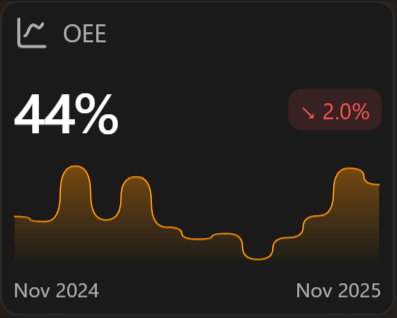

# GMDI Custom Visuals Portfolio

**Power BI Custom Visuals developed by GM Data Insight**

Welcome to the official portfolio of GMDI Custom Visuals — a collection of custom Power BI visuals designed to improve data presentation, reporting flexibility, and analytical experience.

Our goal is to develop practical, flexible, and professional visualization tools that help businesses explore their data and better understand operational performance.

---

## Available Visuals

| Visual | Description | Key Features | Screenshots | Download |
|---|---|---|---|---|
| **GMDI KPI Card** | KPI monitoring with historical performance trends. | KPI value, trend indicator, sparkline, advanced formatting, Flip Experience. |  | [PBIVIZ](GMDI-KPI-Card/releases/) |
| **GMDI Data Table** | Interactive table for detailed data presentation and exploration. | Sorting, flexible formatting, Flip Experience, Key Insights view. |  | [PBIVIZ](GMDI-Data-Table/releases/) |
| **GMDI Mix Analysis** | Analysis of category composition and distribution across periods. | 100% stacked analysis, category highlighting, custom colors, horizontal and vertical layouts. |  | [PBIVIZ](GMDI-Mix-Analysis/releases/) |
| **GMDI Dual Measure Analysis** | Comparison of multiple measures within the same category using independent scales. | Multiple measures, independent axes, layered bars, Top N, independent data label formatting. |  | [PBIVIZ](GMDI-Dual-Measure/releases/) |
| **GMDI Trend Analysis** | Exploration of performance trends across different time periods and granularities. | Multiple trend measures, configurable periods, time-based analysis, Flip Experience, Insights view. |  | [PBIVIZ](GMDI-Trend-Analysis/releases/) |

---

## Installation

GMDI Custom Visuals are distributed as `.pbiviz` packages.

To install a visual in Power BI Desktop:

1. Download the required `.pbiviz` package from the corresponding visual folder.
2. Open Power BI Desktop.
3. In the Visualizations pane, select **Import a visual from a file**.
4. Select the downloaded `.pbiviz` file.
5. The visual will become available in your report.

---

## Version History

Each visual has its own release history and version numbering.

Available versions and downloadable packages are organized in the corresponding visual folders:

- [GMDI KPI Card](GMDI-KPI-Card/releases/)
- [GMDI Data Table](GMDI-Data-Table/releases/)
- [GMDI Mix Analysis](GMDI-Mix-Analysis/releases/)
- [GMDI Dual Measure Analysis](GMDI-Dual-Measure/releases/)
- [GMDI Trend Analysis](GMDI-Trend-Analysis/releases/)

---

## About GM Data Insight

**GM Data Insight (GMDI)** specializes in manufacturing analytics, business intelligence, and production data solutions.

Our work combines manufacturing experience, data engineering, and business intelligence to transform operational data into meaningful insights.

**Explore more:**

- Website: https://gmdatainsight.com
- GitHub: https://github.com/GMDataInsight
- Custom Visuals Development Repository: https://github.com/GMDataInsight/GM-Data-PowerBI-Custom-Visuals

---

*GMDI Custom Visuals — Turning Data into Operational Insights.*